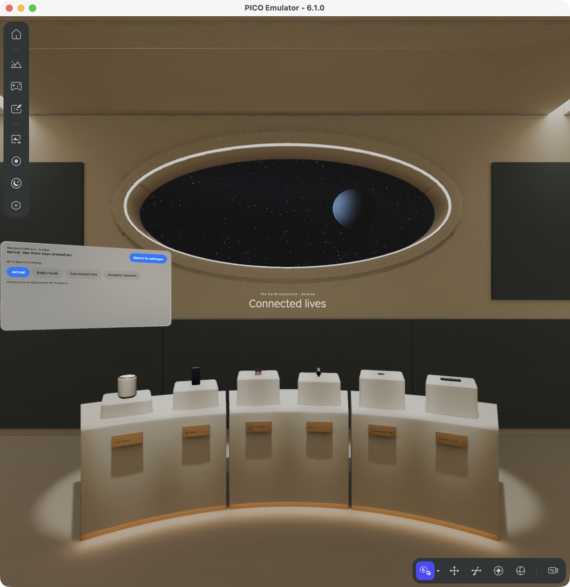

# Everyday Futures — the Earth Collection

Everyday Futures is a museum app for PICO's spatial platform: a future archive of eighteen ordinary objects from the early twenty-first century. Visitors browse a catalogue, open any object in its own rotating 3D view, and reveal miniature stories about three of them: a handled tumbler, a robot vacuum and a smart speaker. They can also step into an immersive archive room built in Blender.

This repository is also a course showing how one person directed AI coding assistants to build and check the app step by step. An AI coding assistant is a tool built on a large language model (LLM) that reads instructions and files and proposes code. The assistants wrote the code, tests and 3D-authoring scripts and ran the checks; the person set the product and art direction and the constraints, and signed in to the emulator. The finished app does not use AI while it runs. You need no AI subscription, API key, headset or development tools to read the course or view the walkthrough.

*Historical emulator frame: the archive's “Connected lives” bay, from build-006, an earlier Lesson 4 build. It is not an image of the current build-008.*

## Who this is for

- **PICO reviewers:** the product, teaching approach and evidence in one place.
- **Learners new to AI-assisted development:** the walkthrough and the beginner guide need no coding experience. The lesson sheets assume you can read basic Kotlin.
- **Developers:** only the third route needs development skills and the PICO tools in [setup and versions](curriculum/SETUP_AND_VERSIONS.md).

## Choose a route

**See the walkthrough.** Download or clone the whole repository, then open `demo/index.html` from your computer in a web browser. It runs offline: nine panels, six with historical emulator stills, about six minutes. Code-hosting websites show its source instead of running it. The Markdown version is [demo/WALKTHROUGH.md](demo/WALKTHROUGH.md).

**Learn the process.** Read [First steps with an AI assistant](curriculum/FIRST_STEPS_WITH_AI.md), then the [course map](curriculum/COURSE_MAP.md) and [Lesson 1](lessons/L1.md). The [prompt library](prompts/PROMPT_LIBRARY.md) and [AI and human decisions](process/AI_AND_HUMAN_DECISIONS.md) show what the assistants produced, what failed and what people decided.

**Inspect the code/setup.** Start at [source snapshots](source/SNAPSHOTS.md), [architecture and vocabulary](curriculum/ARCHITECTURE_AND_GLOSSARY.md), [setup and versions](curriculum/SETUP_AND_VERSIONS.md) and the included [UI module](third_party/POLISH_MODULE.md).

| Lesson | What gets built |
| --- | --- |
| [L0](lessons/L0.md) | Context, requirements and exact inputs; a source-only checkpoint |
| [L1](lessons/L1.md) | Catalogue, details and a 3D study you can turn and reset |
| [L2](lessons/L2.md) | A companion window sharing the same state |
| [L3](lessons/L3.md) | Three miniature stories and reduced motion |
| [L4](lessons/L4.md) | Eighteen exhibits, a separate 3D inspector and the Blender archive |

[PROGRAM_INGREDIENTS.md](PROGRAM_INGREDIENTS.md) maps every part of the program to its folder and entry file.

## What is included and what is not

The museum was built and checked on a signed-in PICO emulator, not on a headset. This repository contains the course, prompts, an editorial development timeline, per-lesson source snapshots, the walkthrough, six historical images, evidence summaries and checksums.

It deliberately omits the Android installer (APK), four exhibit models with their thumbnails, PICO template resources and the original Blender file. **The source here therefore cannot be built as supplied.** All 37 omitted files are listed under `heldItems` in [MANIFEST.json](MANIFEST.json), with reasons in [open items](review/OPEN_ITEMS.md) and [asset provenance and rights](assets/PROVENANCE_AND_RIGHTS.md). No public license is granted.

The project owner keeps most omitted files in a separate asset supplement and decides who receives it. [ASSET_SUPPLEMENT.md](ASSET_SUPPLEMENT.md) explains how the two parts fit together.

## Details and checks

Build identities and evidence are in the [evidence index](evidence/INDEX.md) and [validation](review/VALIDATION.md). To check every file, run `python3 review/verify_checksums.py` from this folder.
