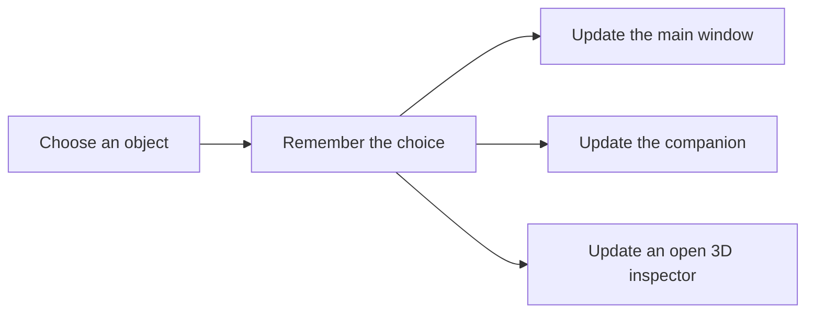

# How the app fits together

Think of the museum as one notebook with several views. The notebook remembers which object you chose, how you turned it, and which objects you saved. Each window reads from that same notebook.

If each window kept its own separate choice, the cup could appear in one window while the other still showed the vacuum. Lesson 3 teaches how to avoid that.

## Find the part you need

Paths below are inside `source/snapshots/build-008/native/app/src/main/java/dev/local/everydayfutures/museum/`.

| Part | What it does | Files to start with |
| --- | --- | --- |
| Object list | Names, descriptions, categories, and model files | `catalogue/Catalogue.kt` |
| Current choices | Selected object, turn angle, and current screen | `state/MuseumState.kt`, `state/MuseumController.kt` |
| Main window | Object cards, details, and the small 3D view | `content/MuseumWindow.kt`, `content/CataloguePanel.kt` |
| Second window | Details or a story that follows the selected object | `content/CompanionWindow.kt`, `content/CompanionStory.kt`, `state/Workspace.kt` |
| Stories | The chapters and changes between them | `state/Story.kt`, `story/StoryScenes.kt` |
| Separate 3D view | A larger view with its own rotation | `content/InspectorWindow.kt`, `content/InspectorPresenter.kt` |
| Archive room | The room, object positions, and Return button | `stage/ArchiveStage.kt`, `stage/ArchiveLayout.kt` |
| Saved choices | Saved objects and comfort settings | `state/MuseumPreferences.kt` |

You do not need to understand every file at once. Follow the feature you are changing, then ask the assistant to explain the relevant file.

## A few choices that matter

Selecting another object updates the title, details, and model together. It also resets the small study view’s angle. The separate inspector has its own rotation.

The main window uses one extra window at a time: the companion or the inspector. The archive is a separate room view. Returning from it restores the catalogue.

Saved objects and comfort settings are kept when the app restarts. Other choices, such as the current selection and search, are remembered while the app is running, not across a full restart.

A story should not undo a change the visitor made while it was open. For example, pressing Reset and then returning from a story should leave the object reset.

## Vocabulary

| Word | Plain meaning |
| --- | --- |
| AI assistant | A tool that can suggest text or code from your instructions. |
| Prompt | The message you send to the assistant. |
| Kotlin | The programming language used for this app. |
| SDK | Libraries and tools for building on a platform. Here, PICO’s Spatial SDK. |
| Emulator | Software on a computer that runs an app in a simulated device environment. |
| APK | An Android app’s installation file. |
| State | The app’s current choices: for example, the selected object and its angle. |
| Shared state | The same choices used by more than one window. |
| Reducer | A function that calculates the next state after an action. |
| Model / GLB | A 3D object file. GLB is the format used for many museum objects. |
| Study | The small selected-object view next to the catalogue. |
| Inspector | The separate, larger 3D object view. |
| Stage / Full Space | PICO’s immersive view, used for the archive room. |
| Build | Turning project files into an app file. |
| Code test | A check run by software. Some tests check logic without opening the app. |
| Snapshot | A saved copy of the project at a particular point. |
| Hash | A file fingerprint used to check whether bytes have changed. |

The [technical architecture record](TECHNICAL_ARCHITECTURE.md) has the full class map and lifecycle details. It describes the original museum, not a new Luna result.
