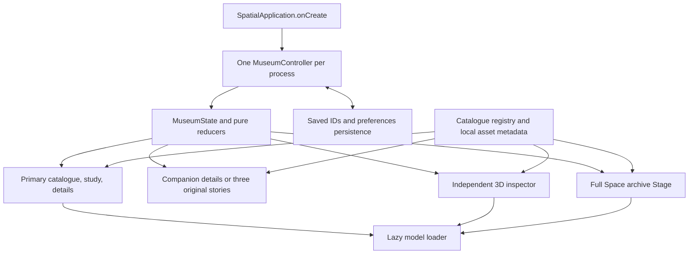

# Current architecture and vocabulary

This map describes build-008's source lineage, not just L1. Built source is `c65959f66d164ee28933f3dd2c09bfe1fc760ff3`; documentation closeout is `0efe2718e0eeb733e2a3b3b2cd300a1703025aa0`. Original source paths below are relative museum citations. Qualified exports and transformed-byte identities are in [source snapshots](../source/SNAPSHOTS.md).

The controller is created before `Application.launch`. Compose snapshot state recomposes every root that reads it. UI actions pass through the controller and pure reducers; markers name their originating surface. Each presentation owns its scene lifetime. A second window does not create a second logical museum.

| Responsibility | Current source under `native/app/src/main/java/dev/local/everydayfutures/museum/` | Contract |
| --- | --- | --- |
| Entry and containers | `platform/SpatialApplication.kt`, `platform/MuseumRuntime.kt`, `Main.kt` | Default primary, DSL companion and inspector, DSL archive Stage; one shared controller |
| Product data | `catalogue/Catalogue.kt`, `CatalogueQuery.kt` | Eighteen stable ids, sections, fact/interpretation copy, model/thumbnail metadata; only original three have stories |
| Shared logic | `state/MuseumState.kt`, `MuseumController.kt`, `Workspace.kt`, `Filter.kt`, `Story.kt`, `Inspector.kt`, `Archive.kt` | Total state transitions and observable window lifecycle; no platform view cached as logical state |
| Durable storage | `state/MuseumPreferences.kt` | Saved ids and three comfort preferences only; app-private SharedPreferences |
| Catalogue and study | `content/MuseumWindow.kt`, `CataloguePanel.kt`, `ObjectPresenter.kt` | Grid/filter/details plus selected model; no eighteen-model preload for thumbnails |
| Model lifecycle | `content/ExhibitLoader.kt`, `ExhibitLoad.kt`, `ModelSource.kt`, `ModelFit.kt` | Cancel obsolete loads, name failures, fit declared bounds; stored GLB descriptor closes after load |
| Story | `content/CompanionStory.kt`, `story/StoryScenes.kt`, `StoryPresenter.kt`, `SceneReadiness.kt` | Reusable chapter data/presenter; scene arrival/loading and bounded returned-failure recovery |
| Inspector | `content/InspectorWindow.kt`, `InspectorPresenter.kt`, `InspectorMotion.kt` | Independent yaw/spin, frame-event subscription, settle under Reduce motion, cancel on disposal |
| Archive | `stage/ArchiveStage.kt`, `ArchiveGeometry.kt`, `ArchiveLayout.kt`, `RoomLayoutParser.kt` | Room and eighteen anchors, loading-aware view, attachment-panel controls, explicit return and recursive disposal |

## State and lifetime

| State | Survives window close/reopen? | Survives process recreation? |
| --- | --- | --- |
| Selected object, study view/orientation | Yes while the process lives | No |
| Saved ids, comfort options | Yes | Yes |
| Story/chapter | Companion close preserves logical story; Return clears it | No |
| Filter/search | Yes while the process lives | No |
| Inspector presentation, archive phase, attached-root counts | Governed by their open/close reducers; not durable | No |

Primary plus at most one auxiliary means companion or inspector, never a request for both to remain live. The controller waits for observed detach before switching roles; pending opens/closes matter. The immersive Stage is a separate surface, with the catalogue minimized while visiting and restored on the app's Return path. System background/resume differs from disposal and must not be described as the same transition.

The story does not mutate study orientation, so Return simply clears story state. Inspector presentation yaw is likewise independent. Selecting a new object resets study orientation, follows an open inspector, and switches an existing story only when the new object has story content. A filter can hide the selected grid item without destroying selection.

Models are local assets. GLBs use uncompressed APK entries to permit `openFd`; the descriptor's lifetime surrounds the suspended load. Scene disposal destroys app-owned entity roots recursively and cancels the inspector update subscription. Entity invalidity is observable; complete native-allocation release remains unproven. See [troubleshooting](TROUBLESHOOTING.md).

## Vocabulary

| Term | Meaning in this course |
| --- | --- |
| Agentic | AI-assisted authoring, implementation and verification; no runtime LLM dependency |
| WindowContainer | SDK-managed spatial window; primary from manifest, auxiliary windows registered through DSL |
| SpatialView | A region embedding entity content in a composition, with initialization/update/lifecycle responsibilities |
| Stage / Full Space | Immersive archive surface entered deliberately; distinct from an adjacent study or window |
| Shared state | One process-owned logical museum observed by all roots, not bundles copied into each window |
| Study | Adjacent selected-object view inside the primary catalogue window |
| Inspector | Separate glass-off Open in 3D window with independent presentation rotation |
| Story | Three-chapter miniature in the companion for tumbler, vacuum or speaker |
| Entity / resource | Scene object and its underlying mesh/material/model resources; destroying one is not proof of all native memory release |
| AttachmentPanel | UI attached to scene content, used by the archive for its persistent controls and labels |
| Reducer | Pure state transition suitable for host logic tests |
| Receipt / checkpoint | A receipt binds one build or observation; a checkpoint names source/history. Their identities are not interchangeable |
| Admitted / opened / LOOK | Gate passed and bound the capture / image actually inspected / recorded visual observations |
| Counted input | Attributed input with observed landing/marker and relevant resulting state; a requested click alone is insufficient |
| Non-gate look / derivative | Diagnostic capture without gate admission / crop, sheet or edited presentation with new bytes and hash |
| Host test / native observation | Logic or tooling executed on the host / observed app on the recorded emulator route; neither automatically proves the other |
| Runtime metric | A platform measurement; the gate's PxrMetric is not established application FPS |

Original architecture documentation was a D0/L1 map and contains dated statements about three procedural objects and window-local ownership. This current summary uses later source and lesson records. Exact source hashes appear in [source notes](../prompts/SOURCE_NOTES.md).
