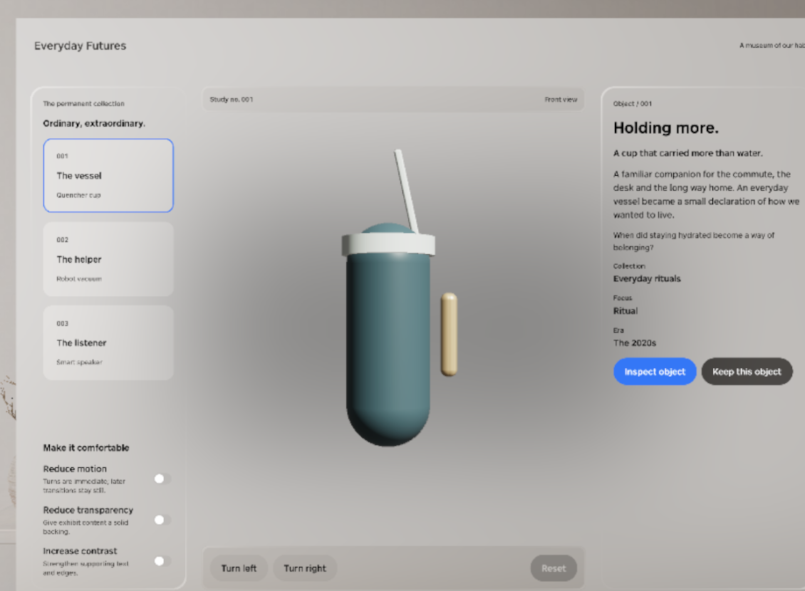
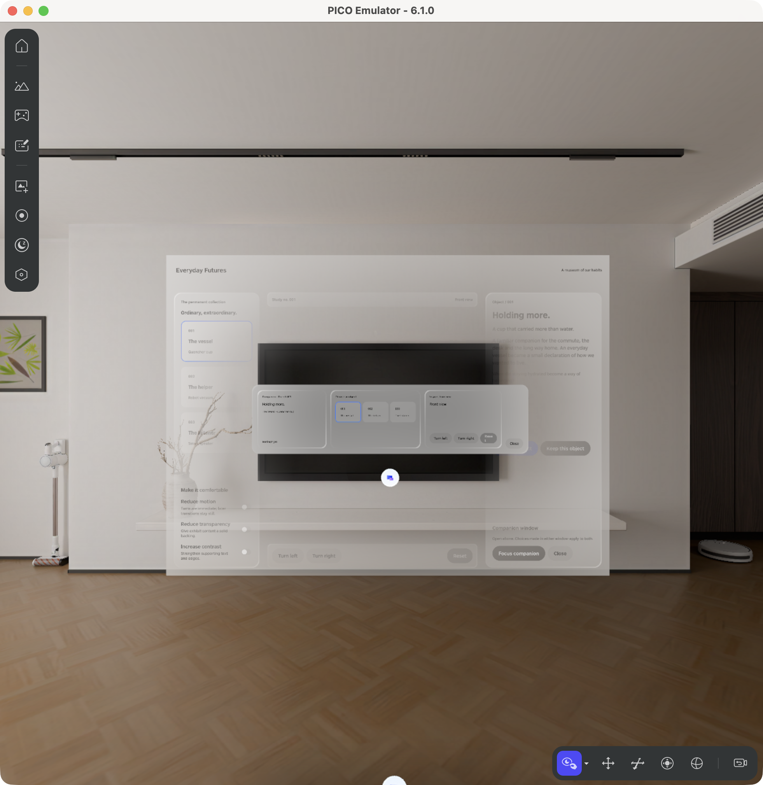
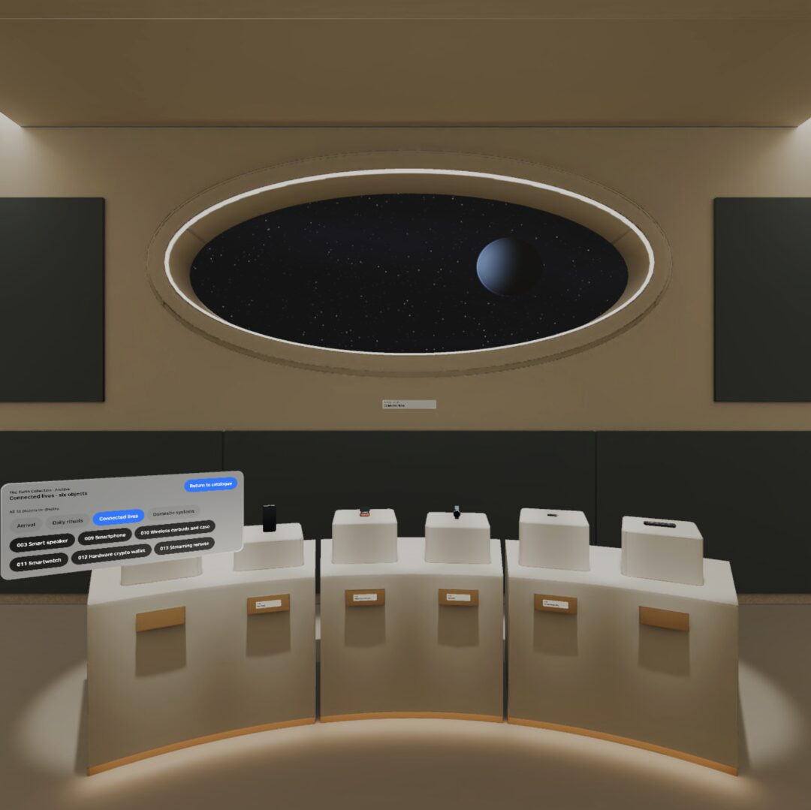

# A picture tour of the museum

These six saved pictures come from different versions of the original app. Select a picture to open its original file at full size, or use the [wide-page tour](index.html).

## Start with three things

We began with a cup, a vacuum, and a speaker. Choose one, read about it, and look at it in 3D.

*Start with the [first lesson](../lessons/L0.md). The original first step was a design and code draft, not yet a running PICO app.*

## Choose, turn, reset

Choose the cup, turn it, and press Reset. The cup should face forward again while staying selected.

*Original three-object version, build-003. This existing crop shows the earlier cup made from simple shapes.*

## The second window is too small

The companion opened, but its labels were too small to read. That gave us a clear next thing to fix.

*Original companion version, build-005. Practice wording: “The new window is too small to read. Can you make it bigger?”*

## Try the larger window

The larger companion has room for the object details and controls. The next check is whether both windows follow the same choice, including after closing and reopening the companion.

*Original companion version, build-006. This picture shows the reopened result; the interaction sequence is described in the original records.*

## Give an object a short story

This is the vacuum’s second chapter. The original cup, vacuum, and speaker each have three chapters, with a way back to the object.

*Original story version, build-003. A still picture does not show how smoothly a chapter change moves.*

## Small labels are hard to read in a room too

The objects were in place, but the wall title was tiny. The room needed another pass inside the app.

*Original collection build-004. This is a previously cropped and resized image, not a picture from a formal app check.*

## Make the way back easy to find

The larger wall title is easier to see. Return to catalogue gives the visitor a clear route out of the room.

*Original collection build-006. One of three bays is visible. This does not establish how every label feels or reads in a headset.*

## A closer look

The original museum also has a separate 3D object window. You can turn the object, start or stop its spin, and reset it.

*This is a description, not a new screenshot. The original inspector image is excluded because of the artwork visible in its background.*

## Try the next small change

The useful habit is the same throughout: ask, try, describe the result, and improve it. Keep the requests small enough that you can tell what changed.

*These are existing pictures from different versions of the original museum, not a continuous run or pictures of the Luna prototype.*

[Picture sources](../evidence/INDEX.md)
