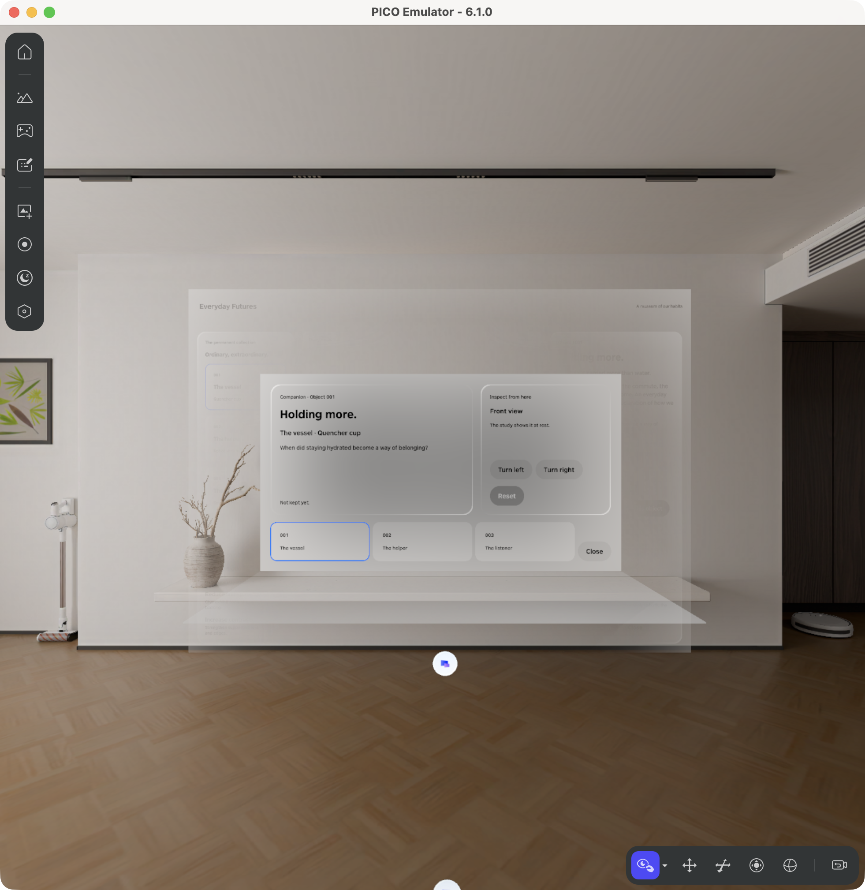

# Lesson 3 — Use two windows

**Your goal:** use a small second window without losing your choice in the main museum.

Start with your three-object app from Lesson 2. A second window is useful when you want to keep information nearby while looking at an object.

## Open a second window

> Add a button that opens a small second window about the object I chose. Opening it again should bring back the same window.

Save the changes and open your app again. Choose the tumbler, then open the new window. Both windows should name the tumbler. Press Open again: you should still have just one small window.

## Keep the windows in agreement

> Let me choose and turn an object from either window, and add Keep to save it. Both windows should show the same choice and whether I have saved it.

Choose the vacuum in the main window. Then choose the speaker in the small window and look back. Turn it and press Keep. Both windows should agree about your choice and show that you saved it.

You are saving an object to your collection. A way to browse only saved objects comes later.

## Close it and come back

Close the small window, choose a different object and reopen it. It should show your latest choice.

Only if it shows the old one, tell ChatGPT exactly what you tried. For example:

> I closed the small window, chose the vacuum and reopened it, but it still shows the tumbler. Please show my current choice.

Repeat the same steps after the change. Use your actual object names if your result differs.

## What happened in the original project

The second window was initially difficult to see and read. Its size and position were adjusted until its controls were readable and the main window remained reachable.

Compare [before](../evidence/media/l2-before.png) with [after](../evidence/media/l2-after.png).

If yours opens outside your view, share a screenshot and use the [window-placement follow-up](../prompts/PROMPT_LIBRARY.md#if-a-window-is-missing).

## Try it yourself

Save an object, close the small window and reopen it. Ask a friend which object is selected and whether it has been saved.

Next: [Lesson 4 — Tell three small stories](L3.md). [More about the original work](reference-L2.md).
