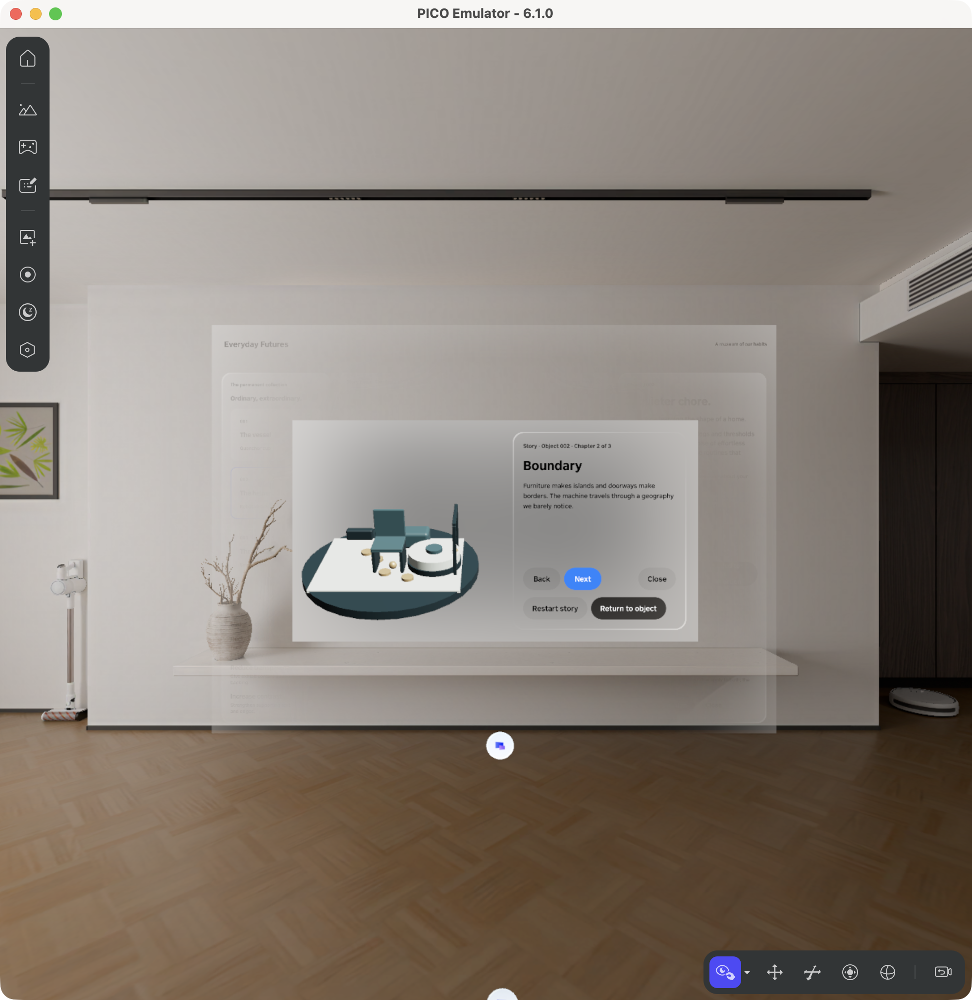

# Lesson 4 — Tell three small stories

**Your goal:** turn each of the three objects into a story you can step through.

Continue with your two-window app. Copy the [three chapter texts](../prompts/PROMPT_LIBRARY.md#story-words-to-copy) for the object you are working on into your conversation.

## Begin with the vacuum

> Tell the vacuum’s story in the small window, starting with its first chapter. Show a little scene with the vacuum, a chair and a crumb.

Open its story. You should see “Routine” and a small scene. The main window should still show the vacuum.

## Move through the story

> Let me go forward and back through the three chapters, with a different little scene for each. Add ways to restart the story and return to the object.

Try Routine, Boundary and Human trace. Go back, restart, then return to the object. The words and scene should agree at each step.

## Add the other two stories

Share the tumbler and speaker’s chapter words, then ask:

> Give the tumbler and speaker their own three-part stories using these words. Choosing a different object should start its story from the beginning.

Try the tumbler’s Ritual, Signal and Afterlife, then the speaker’s Invitation, Connection and Silence. Close the small window during a story and reopen it; check that your place is kept.

## Make movement optional

> When I turn on Reduce motion, change chapters without moving the scene around. Keep the same objects and story words.

Watch a chapter change with this option off, then on. The final scene should match. A picture alone cannot show whether the change moved.

## What happened in the original project

Returning from a story once brought back an old viewing angle, undoing a Reset made while the story was open. The fix kept the visitor’s newer choice.

If this happens in your app, show the steps you took and ask:

> I pressed Reset while reading the story, but returning brought back the old angle. Keep the change I made.

Then repeat those steps to see whether the fix worked.

## Try it yourself

Sketch a different three-part story for the speaker. What would visibly change in each part?

Next: [Lesson 5 — Fill the museum](L4.md). [More about the original work](reference-L3.md).
